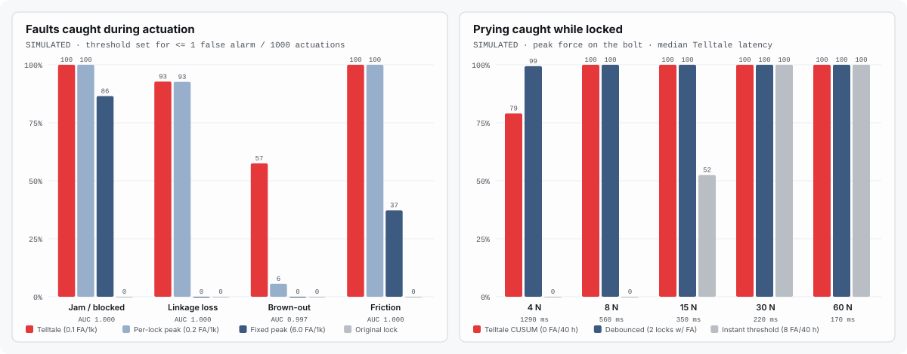
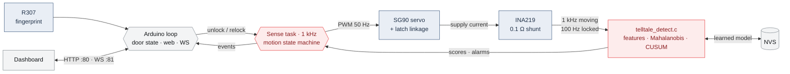

<!-- ════════════════════════════════════════════════════════════════════ -->
<!--                              TELLTALE                                 -->
<!-- ════════════════════════════════════════════════════════════════════ -->

<div align="center">

<!-- animated banner — loops live on GitHub (hand-built SVG + SMIL) -->


<br/>

[](LICENSE)
[](#-hardware)
[](#-how-it-works)
[](#-reproduce-the-results)
[](#-specs-honest)
[](#-contributing)

**A fingerprint door lock whose own servo is the tamper sensor.**
The motor that locks the door also feels who's forcing it.

[🔬 The idea](#-the-idea) · [📊 Results](#-results) · [🛠 How it works](#-how-it-works) · [🔩 Hardware](#-hardware) · [📏 Specs](#-specs-honest) · [🧪 Reproduce](#-reproduce-the-results) · [❓ FAQ](#-faq)

</div>

> [!IMPORTANT]
> **Every result below is simulated.** The detector is the real firmware code, but the current traces come from a physics model of the servo, latch and current sensor ([docs/MODEL.md](docs/MODEL.md)). The firmware compiles for the ESP32 (sizes below) but has not been flashed onto a lock in this revision. Hardware validation is the first roadmap item.

---

## 🛰 What is it?

Formerly *Phantom Door*: an ESP32 lock with an R307 fingerprint sensor, an SG90 servo that pulls the latch, and a web dashboard. It still does all of that.

**Telltale adds one part, a $2 current sensor on the servo's power wire, and turns the servo into a sensor.** A servo that is holding a bolt has to push back when someone pushes the bolt, and pushing back costs current. A jammed latch costs a lot of current. A snapped cord costs less than usual. A dry or iced mechanism costs more while moving. A weak power supply changes the shape. So the lock learns what its own healthy actuations look like, and then it notices when that changes, with no extra sensors on the door.

It tells you, over the dashboard's WebSocket:

- `forced_while_locked` — sustained force on the bolt while the door is locked (prying, shimming, a forced key);
- `servo_power_lost` — the servo stopped drawing power (wire cut, supply failed);
- per actuation: `stall` (jammed, or the door is ajar on relock), `linkage` (cord broken or slack), `brownout`, `friction`.

---

## 🔬 The idea

**Robot arms already do this.** Collaborative robots detect collisions without skin sensors by comparing the motor current they measure with the current their model expects; a residual means something is pushing back ([De Luca et al. 2006](#related-work); survey in [Haddadin et al. 2017](#related-work)). Industrial drives diagnose faults from motor-current signatures ([Thomson & Fenger 2001](#related-work)). Telltale applies that idea to the cheapest actuator there is, a door-lock servo, where the "model" is simply learned from the lock's own first 30 unlocks and 30 relocks.

**The claim, falsifiable and measured in simulation.** With thresholds set on separate validation locks:

> **Telltale flags 100 % of prying attempts of 8 N or more at the bolt (320 of 320 per force level, 80 test locks), with a median latency of 560 ms at 8 N and 220 ms at 30 N, before the bolt clears the strike in 100 % of attempts up to 30 N, and with 0 false alarms in 40 simulated hours of idle with random knocks. An instantaneous overcurrent threshold tuned the same way catches 0 % at 8 N and 52.5 % at 15 N, and still raised 8 false alarms. During actuation it flags 91.3 % of injected faults at 0.1 false alarms per 1000 actuations; a fixed peak-current threshold catches 44.7 % while raising 6 per 1000.**

Two physical facts make it work, and both are in the model:

1. **You cannot move the bolt without telling the motor.** Through the linkage, any push on the bolt reaches the gear train. Small pushes are held by gear stiction and cost nothing, but they also do not move the bolt. To retract the bolt far enough to open the door, the attacker must back-drive the servo out of its dead band, and then the servo's controller fights back with current. The detection floor sits where the bolt starts to move (about 4 N here).
2. **A short knock is not a sustained push.** Knocks and slams also spike the current, sometimes harder than prying does. So the idle monitor is a clipped CUSUM ([Page 1954](#related-work)): it ignores any steady offset smaller than what gear stiction can leave behind (8 mA), clips each sample's evidence at 40 mA so a knock cannot fill the bucket alone, and alarms on sustained evidence.

**Why it matters.** Smart locks are usually attacked through their software ([Ho et al. 2016](#related-work)), but the cheap ones are also easy to force, and they never know it happened. A lock that can say "someone was levering the bolt at 02:13" or "the door didn't actually lock" is more useful than one that only reports what its fingerprint sensor saw.

<a id="related-work"></a>
**Related work.**
A. De Luca, A. Albu-Schäffer, S. Haddadin, G. Hirzinger, "Collision detection and safe reaction with the DLR-III lightweight manipulator arm," *IEEE/RSJ IROS*, 2006 ·
S. Haddadin, A. De Luca, A. Albu-Schäffer, "Robot collisions: A survey on detection, isolation, and identification," *IEEE Transactions on Robotics* 33(6), 2017 ·
W. T. Thomson, M. Fenger, "Current signature analysis to detect induction motor faults," *IEEE Industry Applications Magazine* 7(4), 2001 ·
E. S. Page, "Continuous inspection schemes," *Biometrika* 41(1/2), 1954 ·
B. P. Welford, "Note on a method for calculating corrected sums of squares and products," *Technometrics* 4(3), 1962 ·
G. Ho, D. Leung, P. Mishra, A. Hosseini, D. Song, D. Wagner, "Smart locks: Lessons for securing commodity Internet of Things devices," *ACM ASIA CCS*, 2016.

---

## 📊 Results

<div align="center">

<br><sub>Drawn by <code>python -m sim.evaluate</code> from <code>results/eval.json</code>. All simulated.</sub>
</div>

### Prying while locked (80 test locks, 320 attempts per force)

| Peak force at the bolt | Telltale CUSUM | Median / p90 latency | Before bolt clears strike | Debounced threshold | Instant threshold |
| --- | :---: | :---: | :---: | :---: | :---: |
| 4 N | 79.1 % | 1290 / 1994 ms | 79.1 % | 99.4 % | 0 % |
| 8 N | **100 %** | 560 / 730 ms | 100 % | 100 % | 0 % |
| 15 N | **100 %** | 350 / 490 ms | 100 % | 100 % | 52.5 % |
| 30 N | **100 %** | 220 / 320 ms | 100 % | 100 % (81.2 % before strike) | 100 % |
| 60 N | **100 %** | 170 / 210 ms | 91.6 % | 100 % (31.2 % before strike) | 100 % |
| **False alarms, 40 h healthy idle** | **0** | | | **2 locks** | **8** |

A deliberately slow push (30 N over 20 s, trying to drag the baseline tracker along) was caught in 40 of 40 trials, at a median force of 5.8 N, before the bolt had moved 2 mm.

Honest reading: a *debounced* threshold (300 ms above a level) tuned on the same validation data catches almost as much, and more at 4 N, but it fired falsely on 2 of the 80 test locks and is slower once the force is large. The gain is mostly the sensing itself; the CUSUM buys zero false alarms and lower latency on hard attacks. At 30 N and above the SG90 is simply overpowered: the bolt moves 2 mm before anything can react, so "before it clears the strike" is the number that matters. A metal-gear MG90S raises that bar.

### Faults during actuation (80 test locks, 400 trials per severity, 20,000 healthy actuations)

| Fault | Severity | Telltale | Per-lock peak threshold | Fixed peak threshold |
| --- | --- | :---: | :---: | :---: |
| Jam on unlock | 30 / 50 / 70 / 90 % of travel | 100 / 100 / 100 / 100 % | 100 % all | 100 / 100 / 100 / 95.0 % |
| Jam on relock (door ajar) | 30 / 50 / 70 / 90 % | 100 % all | 100 % all | 100 / 100 / 95.8 / 1.3 % |
| Linkage broken | — | 100 % | 100 % | 0 % |
| Linkage slack | +1.5 / 3 / 5 mm | 71.0 / 100 / 100 % | 95.3 / 87.7 / 87.5 % | 0 % |
| Brown-out | 4.6 / 4.4 / 4.2 V | 14.2 / 62.5 / 95.8 % | 1.3 / 4.3 / 11.3 % | 0 % |
| Added friction | ×1.5 / 2 / 3 | 100 % all | 100 % all | 10.0 / 32.0 / 69.8 % |
| **All faults** | | **91.3 %** | 82.6 % | 44.7 % |
| **False alarms per 1000 healthy** | | **0.1** | 0.25 | 6.0 |

ROC AUC per fault class (Telltale): jam 1.000, linkage 0.9999, brown-out 0.9966, friction 1.000. Of detected faults, 88.1 % get the right class from the sign pattern of the deviations.

**Method.** 40 validation and 80 test locks, each with its own friction (±25 %), spring (±10 %), supply (4.8–5.2 V) and sensor offsets. Each learns from 30 healthy cycles, then scores 125 more and every fault on a copy of its model. Thresholds are set on validation for ≤ 0.5 false alarms per 1000, then frozen. The per-lock baseline is a peak threshold calibrated on each lock's own learning runs; the fixed baseline is one fleet-wide peak threshold (what most firmware does). Full numbers, confidence intervals and the extra experiments below are in [`results/eval.json`](results/eval.json).

**What else the data says.**
- *Ablation:* dropping the template residual cuts detection from 91.3 % to 77.0 % (and raises false alarms from 2 to 15 per 20,000); peak and mean alone give 71.3 %.
- *Stress:* re-drawing the full healthy spread on **every** actuation (not just per lock) keeps false alarms at 0.75 per 1000 but drops overall detection to 74.9 % (subtle slack, brown-out and ×1.5 friction suffer). In that regime a per-lock peak threshold does about as well (77.6 %).
- *Drift:* friction creeping up 40 % over 400 actuations gives 2.9 % false alarms with gated adaptation versus 15.5 % with a frozen model, and a sudden ×2 friction step afterwards is still caught 15 of 15 times. Real wear is much slower than this test.

---

## ✨ Features

<table>
<tr>
<td width="33%" valign="top">

### 🫳 Feels prying
A clipped CUSUM on the holding current flags sustained force on the bolt while locked, with an onset estimate, and ignores knocks and the small steady currents a servo is left with after it settles.

</td>
<td width="33%" valign="top">

### 🧠 Learns its own lock
The first 30 unlocks and 30 relocks build a per-lock model (Welford). After that it adapts slowly, and only on clearly healthy actuations, so a fault or an attacker cannot teach it a new normal.

</td>
<td width="33%" valign="top">

### 🩺 Names the fault
Eight features per actuation and a template residual, scored with a diagonal Mahalanobis distance. The sign pattern says *jam*, *linkage*, *brown-out* or *friction*.

</td>
</tr>
<tr>
<td valign="top">

### 🚪 Knows the door didn't lock
A relock that stalls (door ajar, strike misaligned) is detected, retried twice and reported, instead of leaving you with a "locked" icon on an open door.

</td>
<td valign="top">

### ⏱ Never blocks
Servo motion moved from `delay()` loops into a 1 kHz FreeRTOS task. Wi-Fi, the web server and the fingerprint UART can't disturb the sample clock.

</td>
<td valign="top">

### 🧩 One codebase, tested twice
The detector is portable C99 with no heap. The ESP32 runs it, the host unit tests run it, and the Python evaluation runs it through ctypes. No Python re-implementation.

</td>
</tr>
</table>

Everything from Phantom Door is still there: fingerprint unlock with retry, enroll and delete from the web UI, NVS user names, 3 failures → 30 s lockout, 4 s hold then auto-relock, LED patterns, watchdog, WebSocket dashboard.

---

## 🛠 How it works



**While moving** (unlock 1080 ms, relock 968 ms), the sense task writes the commanded angle every millisecond, reads the INA219 at 9-bit resolution and streams each sample into the detector. At the end of the window it computes peak, mean, energy, time-to-peak (reported, not scored: it is bimodal on a 50 Hz servo), settle time, holding plateau, a 32-bin template residual and the load centroid, then scores them against the learned mean and variance.

**While locked**, the INA219 switches to 12-bit with 16× averaging and is read at 100 Hz. Each locked period anchors its own reference on a quiet stretch (within 8 mA of the learned baseline), then the CUSUM runs: upward evidence means force on the bolt, a drop below the learned electronics-only baseline means the servo lost power.

**Why the linkage matters.** The original Phantom Door pulled the latch with a single cord. A cord can only pull, so prying the bolt back just slackens it and the servo never feels it. Telltale's reference mechanism uses a push-pull cable or a tensioned cord loop, so force on the bolt reaches the horn in both directions. With a pull-only cord, jams, linkage loss, brown-out and friction are still detected; forced-while-locked is not.

---

## 🔩 Hardware

| Part | Role | Rough price |
| --- | --- | --- |
| ESP32 DevKit (ESP32-WROOM-32) | brains, Wi-Fi | ~$5 |
| R307 fingerprint module | authentication | ~$12 |
| SG90 micro servo (MG90S metal-gear recommended) | actuator *and* sensor | ~$2 (~$4) |
| INA219 breakout with 0.1 Ω shunt | servo supply current | ~$2 |
| 470 µF + 100 µF electrolytic caps | supply bulk / sensor decoupling | ~$0.50 |
| Spring latch + push-pull cable or cord loop | bolt and two-way linkage | ~$6 |
| 5 V 2 A supply, wires | power | ~$5 |
| **Total** | | **≈ $33** |

| From | To | Notes |
| --- | --- | --- |
| R307 RX / TX | GPIO 17 (TX2) / GPIO 16 (RX2) | 57600 baud |
| R307 VCC / GND | 3.3 V / GND | 100 µF close to the sensor |
| SG90 signal | GPIO 18 | LEDC, 50 Hz, 16-bit |
| 5 V rail | INA219 VIN+ | 470 µF on the rail, *before* the shunt |
| INA219 VIN− | SG90 V+ | all servo current flows through the shunt |
| INA219 SDA / SCL | GPIO 21 / GPIO 22 | 400 kHz I²C, address 0x40 |
| INA219 VCC / GND | 3.3 V / GND | common ground with the servo supply |
| LEDs | GPIO 2 (built-in), GPIO 4 | status / feedback |
| Enroll button | GPIO 0 (BOOT) | active low |

> [!WARNING]
> Keep the big capacitor on the supply side of the shunt. A large capacitor right at the servo hides fast current changes from the sensor. And never power the servo from the ESP32's 3.3 V pin.

---

## 📏 Specs (honest)

| | Value | Status |
| --- | --- | --- |
| Firmware build (esp32dev, Espressif32 6.13.0, Arduino-ESP32 2.0.17) | RAM 49,592 B (15.1 %), Flash 845,085 B (64.5 %) | **compiled**, not flashed |
| Detector state (`tt_detector_t`) | 864 B, no heap | measured (`sizeof`, host) |
| Saved model in NVS (`tt_persist_t`) | 424 B with CRC-32 | measured (`sizeof`, host) |
| Detector cost | 19 ns/sample moving, 27 ns/sample idle on an x86-64 host | host only; ESP32 cost not measured |
| Sampling | 1 kHz (9-bit) moving, 100 Hz (12-bit ×16) locked | in firmware; timing not measured on hardware |
| Prying detection | 100 % ≥ 8 N, median 560 ms at 8 N | **simulated** |
| Actuation faults | 91.3 % at 0.1 FA / 1000 | **simulated** |
| Learning | 30 unlocks + 30 relocks, ~20 s of locked idle | design |

| Modelled | Not modelled / not validated yet |
| --- | --- |
| DC motor with back-EMF, gear ratio and efficiency, P-controller with dead band and saturation, 50 Hz command frames, Coulomb + viscous friction with stiction (gear and bolt), compliant two-way linkage with lost motion, spring latch, end stops, supply resistance, INA219 quantisation, noise, offset and gain | Real hardware of any kind · the 50 Hz pulse-stretched drive of analog servo ICs (averaged duty used) · temperature, wear, gear backlash, gear stripping · lateral loads on the bolt and real knock spectra · ESP32 timing jitter and I²C errors |

> [!CAUTION]
> The remote endpoints (`/unlock`, `/enroll`, `/delete`, `/relearn`) are **still unauthenticated** on your LAN, as they were in Phantom Door. A tested HMAC-SHA256 challenge/response core is already in the firmware folder ([`telltale_auth.c`](firmware/telltale/telltale_auth.c), RFC 4231 vectors in [`tests/c/test_crypto.c`](tests/c/test_crypto.c)), but wiring it into the endpoints and the dashboard is the next roadmap item. Keep the lock on a trusted network.

---

## 🚀 Run it

<table>
<tr>
<td width="50%" valign="top">

### 🙂 For users

1. Wire it as in [Hardware](#-hardware). Use a push-pull linkage if you want prying detection.
2. Put your Wi-Fi name and password in [`firmware/telltale/telltale.ino`](firmware/telltale/telltale.ino).
3. Flash it (Arduino IDE with ESP32 core 2.0.x, or PlatformIO below).
4. Open [`index.html`](index.html) **from your computer over http** (see the FAQ about https), enter the lock's IP.
5. Lock and unlock it 30 times. After that it knows its own normal.

</td>
<td width="50%" valign="top">

### 🧑‍💻 For developers

```bash
git clone https://github.com/Zero-State-Logic/Telltale
cd Telltale
pio run                      # build the firmware (esp32dev)
pio run -t upload            # flash
./tools/test_all.sh          # C + Python tests
python -m sim.evaluate       # full simulated evaluation (~6 min)
```

On Linux / macOS: `make test` and `make eval`.

</td>
</tr>
</table>

---

## 🧪 Reproduce the results

```bash
./tools/build.sh             # C core: unit tests, footprint bench, shared library (MSVC on Windows, cc elsewhere)
./tools/test_all.sh          # 43 C tests (test_detect 23, test_crypto 7, test_auth 13) + 25 Python tests
python -m sim.evaluate       # writes results/eval.json, results/footprint.json, docs/assets/results.svg
python -m sim.svgchart       # redraw the chart from results/eval.json only
```

Python 3 with numpy is the only dependency (no SciPy, no plotting library). The evaluation uses fixed seeds; `--quick` runs a small smoke version in about 90 s. The physics, the scenarios and every parameter are in [`sim/`](sim) and [docs/MODEL.md](docs/MODEL.md).

---

## 📁 Project layout

```
Telltale/
├─ firmware/telltale/
│  ├─ telltale.ino           🔐 the lock: fingerprint, door state, web routes, WebSocket alerts
│  ├─ tt_sense.cpp/.h        ⏱ 1 kHz sense task: motion state machine, INA219, detector, NVS
│  ├─ telltale_detect.c/.h   🧠 the detector (portable C99, also run by tests and the simulator)
│  ├─ telltale_motion.c/.h   🦾 commanded trajectories (shared with the simulator)
│  ├─ telltale_ina219.c/.h   🔌 INA219 register maths
│  ├─ telltale_persist.c/.h  💾 model save / restore with CRC-32
│  └─ telltale_sha256.c/.h, telltale_auth.c/.h   🔑 HMAC challenge/response core (not wired yet)
├─ sim/                      🧪 physics, sensor model, scenarios, ctypes binding, evaluation, chart
├─ tests/                    ✅ C unit tests (tests/c) and Python tests
├─ results/                  📊 eval.json, footprint.json
├─ tools/                    🛠 build.sh, test_all.sh, msvc.bat, DLL export list
├─ docs/                     📐 MODEL.md, README assets
├─ index.html                🖥 the dashboard (published by GitHub Pages)
└─ platformio.ini            ⚙ esp32dev build
```

---

## 🗺 Roadmap

- [x] Physics model of servo, linkage, latch and INA219 with healthy spread and six fault types
- [x] Portable C detector: per-actuation features + Mahalanobis + sign-pattern classes, idle CUSUM
- [x] Evaluation against fixed and per-lock threshold baselines, ablation, stress and drift runs
- [x] Firmware: non-blocking 1 kHz sense task, INA219, learning mode, NVS model, WebSocket alerts (compiles)
- [x] HMAC-SHA256 challenge/response core with RFC 4231 tests
- [ ] **Bench validation on a real SG90 / MG90S + INA219**, then re-fit the model to the measurements
- [ ] Wire HMAC challenge/response into `/unlock`, `/enroll`, `/delete` and the dashboard
- [ ] Live current trace and score panel in the dashboard (the data is already streamed over WebSocket)
- [ ] Serve the dashboard from the ESP32 itself, so no https/http mixing is needed
- [ ] Model the 50 Hz pulse-stretched drive; cross-check brown-out with the INA219 bus voltage

---

## 🤝 Contributing

**Students and first-time contributors are exactly who this is for.** The most valuable contribution right now is a real measurement: wire an INA219 to a servo lock, log a few hundred actuations and a few pry attempts, and open a PR with the CSV. The detector is one C file with its own tests, and the simulator is plain numpy, so new fault types and better models are self-contained changes.

---

## ❓ FAQ

<details>
<summary><b>Is this tested on a real lock?</b></summary>
<br>
Not yet. The firmware compiles for the ESP32 and the detector code is the same code the evaluation runs, but every number on this page comes from a simulated servo. The model is built from SG90 datasheet figures plus clearly labelled assumptions (<a href="docs/MODEL.md">docs/MODEL.md</a>). Bench validation is the first roadmap item, and the numbers may well move.
</details>

<details>
<summary><b>Why not just check for overcurrent?</b></summary>
<br>
A fixed overcurrent check finds jams, and that is about it. A broken cord or a weak supply makes the current <i>smaller</i> or just differently shaped, and the healthy range differs from lock to lock. In simulation a fixed peak threshold caught 44.7 % of faults (and raised 6 false alarms per 1000 on locks it was not tuned on). A per-lock peak threshold does much better (82.6 %), and Telltale's extra features add brown-out and the larger slack cases on top (it is weaker than the per-lock threshold on 1.5 mm of slack). While locked, an instantaneous threshold has to sit above knock spikes, so it misses moderate prying entirely.
</details>

<details>
<summary><b>Can an attacker teach it that prying is normal?</b></summary>
<br>
The actuation model only adapts on actuations scored as clearly healthy, with a small gain. The idle baseline only tracks samples within 2 mA of itself, never moves more than 3 mA from what it learned, and each locked period's reference is clamped to within 8 mA of it. A deliberately slow 20-second push was caught every time in simulation, at about 6 N.
</details>

<details>
<summary><b>Does it work with the original single pull cord?</b></summary>
<br>
Partly. A pull-only cord can't transmit a push on the bolt, so forced-while-locked won't be seen. Jams, a door left ajar, a broken or slack cord, brown-out and friction still change the actuation current and are still flagged.
</details>

<details>
<summary><b>Can I control my lock from the GitHub Pages dashboard?</b></summary>
<br>
Browsers block an https page (GitHub Pages) from calling an http device on your LAN ("mixed content"), so the hosted page cannot reach the lock. Open <code>index.html</code> locally instead, for example <code>python -m http.server</code> in the repo and then <code>http://localhost:8000/?ip=&lt;lock-ip&gt;</code>. The firmware sends CORS headers for this. Serving the dashboard from the ESP32 itself is on the roadmap.
</details>

<details>
<summary><b>What does the detector cost on the ESP32?</b></summary>
<br>
864 bytes of state, no heap, and a few dozen float operations per sample (19–27 ns per sample on a desktop; the ESP32 has a single-precision FPU, but its exact cost has not been measured yet). The whole firmware uses 15 % of RAM and 65 % of flash.
</details>

---

## 📜 License

MIT — free for everyone, for any use, forever. See [LICENSE](LICENSE).

## 🙏 Acknowledgements

Built on the [Adafruit Fingerprint Sensor Library](https://github.com/adafruit/Adafruit-Fingerprint-Sensor-Library), [arduinoWebSockets](https://github.com/Links2004/arduinoWebSockets), [ArduinoJson](https://arduinojson.org/) and the Espressif [Arduino-ESP32](https://github.com/espressif/arduino-esp32) core. The idea is borrowed with gratitude from the sensorless collision-detection work on robot manipulators cited above.

<div align="center">
<br>
<b>If you build locks or robots, star the repo and help put the first real current traces on it.</b>
<br><br>
<sub>TELLTALE · the motor that locks the door also feels who's forcing it</sub>
</div>
